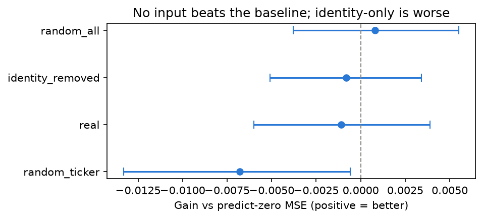
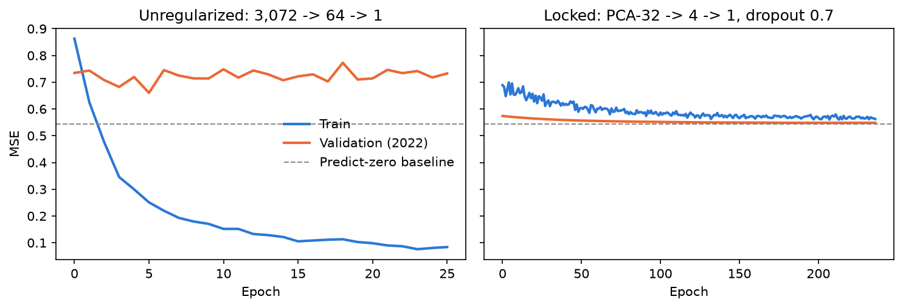
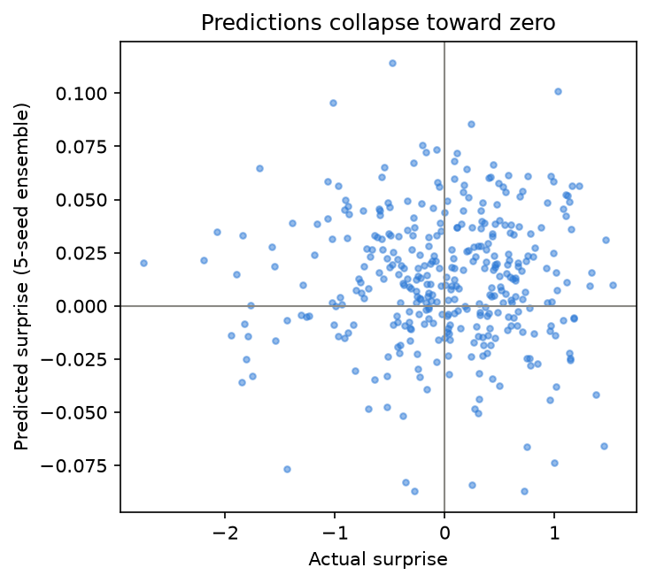

# Check in 2: Neural Baseline for Earnings-Call Volatility Surprise

## Part 1: Recap

During this portion of the project, my initial question remains the same: Do earnings-call transcripts predict post earnings volatility beyond the company's own history?

The target for this check in is the quarter adjusted 3 day volatility surprise with a training split from 2019-2021 (990 calls), validation set of 2022 (360 calls), and a test set of 2023 (360 calls).

In this check in, I trained an MLP head on frozen embeddings, tuned it on validation, and evaluated four input conditions with sanity checks and confidence intervals. I found that no input beats predicting zero surprise, and identity only input does significantly worse.

## Part 2: Neural Baseline

In this section, the approach is feature extraction, a small MLP head on frozen OpenAI transcript embeddings. The inputs had 4 conditions: real embeddings, random ticker (identity only), random all (no information), identity removed (each call's embeddings minus the company's average past embedding).

During this phase, I standardized the inputs using training set statistics only, then reduced them to 32 dimensions with PCA fit on the training data only. The architecture is 32 to 4 to 1, ReLU, dropout 0.7, with a linear output.

Training used an MSE loss, Adam with a learning rate 1e-4 and weight decay 1e-2, with a batch size of 64, up to 400 epochs, and early stopping on validation MSE with a patience of 20. Early stopping stops training once validation MSE hasn't improved for 20 epochs and restores the best weights. This prevents the model from memorizing the training calls.

My first model (3072 to 64 to 1 with 196,737 parameters) overfit badly. Training MSE fell to 0.08 while validation stayed near 0.73. I then searched two 24 configuration grids, changing hidden size, dropout, weight decay, learning rate, and PCA dimensions, on the validation set only. The most constrained configuration came closest to the baseline so that is what I chose.

Every condition was trained with 5 seeds. I report mean plus or minus standard deviation, and final test predictions are a 5 seed ensemble.

Two sanity checks confirm the pipeline works.
- The model memorizes 32 training calls (loss 0.66 to 0.0002)
- The same pipeline predicts sector with 90.8% accuracy on real embeddings vs 8.9% on random all (chance 10%)

## Part 3: Results

| Input | Test MSE | Gain vs. predict-zero (0.525) | 95% bootstrap CI | Spearman |
|---|---|---|---|---|
| Real embeddings | 0.527 | −0.001 | [−0.006, 0.004] | +0.00 |
| Identity-removed | 0.526 | −0.001 | [−0.005, 0.003] | +0.00 |
| Random-all (no information) | 0.525 | +0.001 | [−0.004, 0.006] | +0.06 |
| Random-ticker (identity only) | 0.532 | −0.007 | [−0.013, −0.001] | −0.10 |

- No input is distinguishable from predicting zero. Random ticker is significantly worse.
- Given only company identity, the model learns company specific patterns from 2019 - 2021 that don't hold in 2023. This is why the random ticker is worse
- Predictions have a spread of 0.03-0.05 against an actual spread of ~0.72 so the models effectively predict no surprise
- The model matches the baseline in all four quarters of 2023
- Adam and SGD at several learning rates all converge to the validation baseline. This means that the optimizer changes how fast the model gets there, but not where it gets to.

Trained on raw volatility instead of the surprise, the network beats the global mean given identity alone (random ticker 0.579 vs 0.633) but not given no information (random all 0.636). This indicates that it can learn company level structure, but the embeddings carry nothing detectable about what changed in given a call.

## Part 4: Qualitative Examples

Because the model predicts close to zero for every call, the most helpful examples are the calls it missed and what drove the misses. This can be broken down into missed real events, label artifacts, successes, and understanding what the model leaned on.

### Missed Real Events

The biggest missed real events in the test set include Meta's call from February of 2023, LLY's call from August of 2023, and AT&T's call from April of 2023. For Meta's call, the stock rose 21.8%. The actual surprise volatility was +1.37, but the model predicted -0.04. LLY's call from August of 2023 had a surprise volatility of +1.46 but the model predicted only +0.03, and AT&T's call in April of 2023 saw the stock fall 11% with a surprise volatility of +1.45 but the model predicted -0.07.

The reaction to these calls was large. These should contain the exact flags that the model can pick up on. However, the model didn't pick them up and predicts close to zero everywhere. 

### Label Artifacts

The 3 day label is the standard deviation of the three daily returns around their own mean. If a stock rises or falls at a steady rate, the returns barely vary and the label looks calm. For example, DLR's call in April of 2023 saw the stock fall 7% over the 3 days, but the 3 day label scored it among the calmest calls. This means that some of the errors of the model are measurement problems.

### Successes

The model scored well in calm quarters such as PFE in Q3 of 2023 or Dominion in Q1 of 2023. The model predicted near zero for these and was very close to correct. However, this comes with a clear caveat. This wasn't the model picking up signal. Instead, it was the fact that the model predicts near zero for everything, making it right when nothing unusual happens.

### What the Model Leaned on

The five highest predictions by the model were all JNJ and SRE, with the largest prediction being +0.11. However, the actual surprise for these five calls ranged from -1.02 to +1.03. This indicates that the model learned something at the company level, not from the call content itself. This is consistent with the random ticker result: given only company identity, the model learns company patterns from 2019-2021 that don't hold in 2023, and does worse than predicting zero.

## Part 5: Failures

The model fails in five identifiable ways: overfitting, collapse to zero, identity reliance, missed real events, and label artifacts. Overfitting and collapse to zero are failures of the model, identity reliance and missed real events are failures of the input, and label artifacts is a failure of the target.

### Overfitting 
The first unregularized model memorized the training set. With 196,737 parameters on 990 training calls, the training MSE fell to 0.08 while validation stayed around 0.73. The test MSE was 19% worse than predicting zero. This is because the model had about 200 parameters per training example on a target that's mostly noise.

*Left: the unregularized model overfits (train 0.08, validation ~0.73). Right: the regularized model converges just above the predict-zero baseline (dashed).*

### Collapse to Zero 
Once regularized enough to stop overfitting, every configuration converged on predicting no surprise. The prediction spread was 0.03-0.05 versus an actual spread of 0.72. No configuration beat the baseline on validation. With no learnable signal, the MSE minimizing answer is zero.

*Predictions stay within about plus or minus 0.1 while actual surprises span -2.7 to +1.5*

### Identity Reliance 
The model doesn't learn actual information discussed on the call; instead, it learns company level information. For example, the random ticker is significantly worse than zero (CI -0.013 to -0.001). The top predictions were all JNJ and SRE. In the positive control, identity only input can predict raw volatility (0.579 vs 0.633). This is because the embeddings mainly encode who is speaking. This is similar to what we found in check in 1 where calls from the same company were more similar than calls from other companies.

### Missed real events
Large call driven moves weren't predicted. For example, META's increase by 21.8%, LLY's increase by 14.8%, and AT&T's decrease by 11% were all predicted around zero. This is due to each ~9,400 word call being squeezed into one embedding, which may be truncated past the embedding model's input limit and averaging prepared remarks with the Q&A. The specific content that drove the move gets washed out. This is the 'squeezing a sentence into one vector' bottleneck from the transformers lecture that we discussed in class. This problem is what attention was introduced to solve, which motivates the attention pooling plan in Part 6.

### Label Artifacts
As discussed earlier, the 3 day label scores steady directional moves as calm. DLR fell 7% over 3 days but was labeled among the calmest calls. This is because the target measures spread around the 3 day mean, not the size of the move. Some errors are measurement problems.

### Summary 
The pipeline itself works. It overfits when unregularized, passes the tiny overfit check, classifies sector at 90.8% accuracy, and learns company level volatility from identity. The failure is that the current input, one embedding per call, doesn't expose call specific content, and the 3 day target adds noise. Part 6 targets both.

## Part 6: Check in 3 Plan
Check in 3 targets the two failures that are about the input and the target, while keeping the same evaluation so results are comparable.

### Better Input
To fix the missed real events, I plan on splitting each call into prepared remarks and Q&A. I will break each section into chunks of about 512 tokens and embed each chunk with a pretrained encoder only model. Encoder only fits because, per the lecture, encoders are for understanding and decoders are for generating. As a result, each call becomes a sequence of chunk embeddings instead of one vector. 

### Pooling the Chunks
Calls have different numbers of chunks, so batches are padded with a padding mask. The baseline model will have masked mean pooling. The main model will have attention pooling. A learned query vector scores each chunk's key. The scores go through a softmax with negative infinity at padded positions, and the output is the weighted sum of the chunk values. An MLP head then predicts the surprise. 

I will also have a Q&A only input to test whether the signal lives where analysts push back.

### Remove Identity from the New Input
Using the same idea as this check in, each call's pooled representation will be compared with the average of the company's past calls. The model sees what is different about this call rather than who is speaking

### Better Target
To fix the label artifacts, I will report results on standard realized volatility alongside the paper's label, plus the 7 day window as a robustness check.

### Controls and Evaluation
Use the same splits, metrics, 5 seeds and bootstrap CIs. Additionally, I will keep the random ticker and random all controls, and add the shuffled transcript control (swap transcripts between quarters of the same company). This will allow the results to be comparable. Success will be beating the predict zero baseline and the shuffled and random ticker controls on 2023. 

## Part 7: AI Disclosure and References

### AI Disclosure
## AI Disclosure
I used Claude in the following ways:
- Debugging: Debugging code and making sure pytorch wasn't silently breaking in any of my code.
- Title Names, Markdown Documentation, Spellchecking, and Checking Number Accuracy: Used it for Markdown formatting in check-in-2.md. Additionally, I used it for spellchecking and ensuring that all the numbers I wrote in the check in matched my outputs from neural_baseline.ipynb.

### References
Yu, D., Liu, Z., & He, H. (2025). Same Company, Same Signal: The Role of Identity in Earnings Call Transcripts. *Findings of the Association for Computational Linguistics: ACL 2025.* https://aclanthology.org/2025.findings-acl.946/